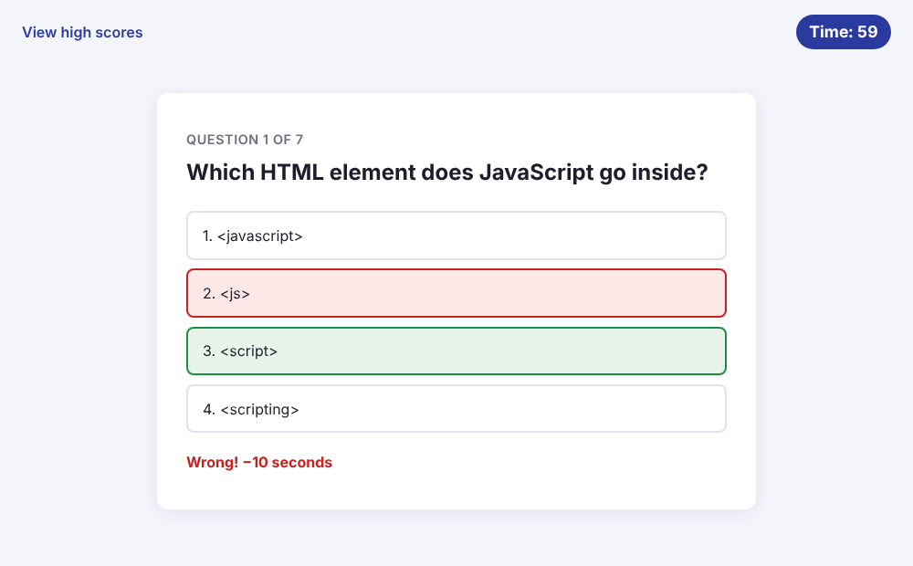

<h1 align="center">🧠 Coding Quiz</h1>

<p align="center">A timed, multiple-choice quiz on JavaScript fundamentals with a high-score board.</p>

<p align="center">
  
  
  
</p>

<p align="center"><a href="https://christiankrantz11.github.io/coding-quiz/"><strong>🚀 Live Demo</strong></a></p>

<p align="center">
  
  
</p>

## Features

- 7 multiple-choice questions on JavaScript fundamentals
- 75-second countdown timer. Every wrong answer costs 10 seconds, and the timer turns red in the final 10 seconds.
- Instant on-page feedback after each answer. A wrong answer also highlights the correct one.
- The game ends when every question is answered or the timer reaches 0
- Your score is the time you have left. Save it with your initials.
- High-score board sorted from best to worst, keeping the top 10 in `localStorage`
- Clear the high scores or play again at any time
- Keyboard-friendly, with a responsive layout for desktop and mobile

## Built With

- HTML, CSS and JavaScript (no libraries)

## Running Locally

No build step is needed.

1. Clone the repo:
   ```bash
   git clone https://github.com/ChristianKrantz11/coding-quiz.git
   ```
2. Open `index.html` in your browser.

## User Story

<details>
<summary>Original assignment user story</summary>

```
AS A coding bootcamp student
I WANT to take a timed quiz on JavaScript fundamentals that stores high scores
SO THAT I can gauge my progress compared to my peers
```

</details>

## Author

[ChristianKrantz11](https://github.com/ChristianKrantz11)
